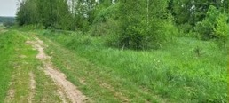
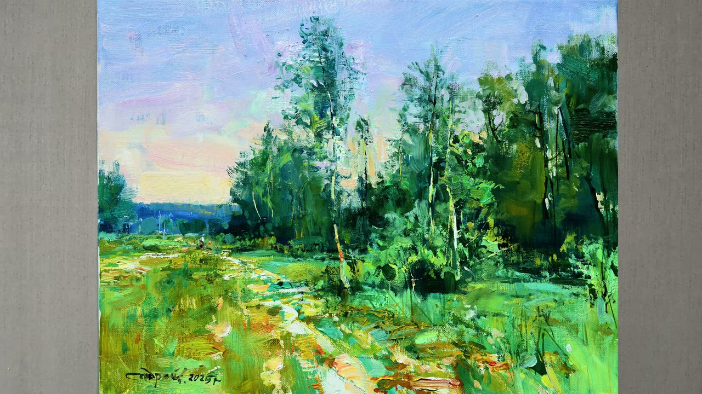
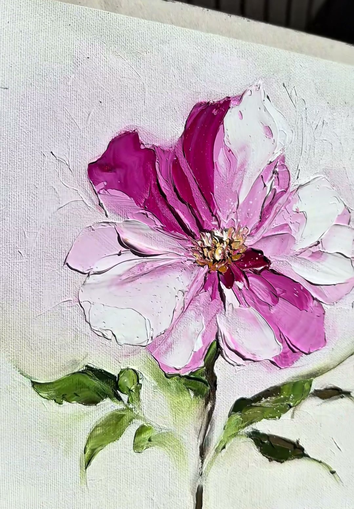
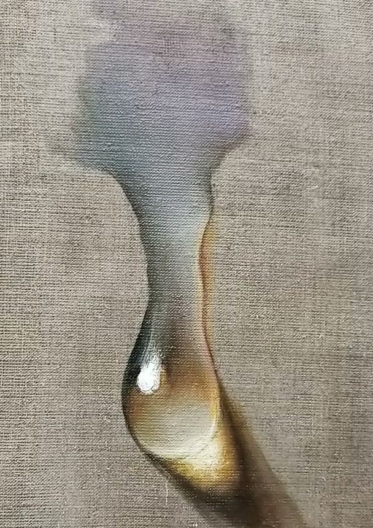
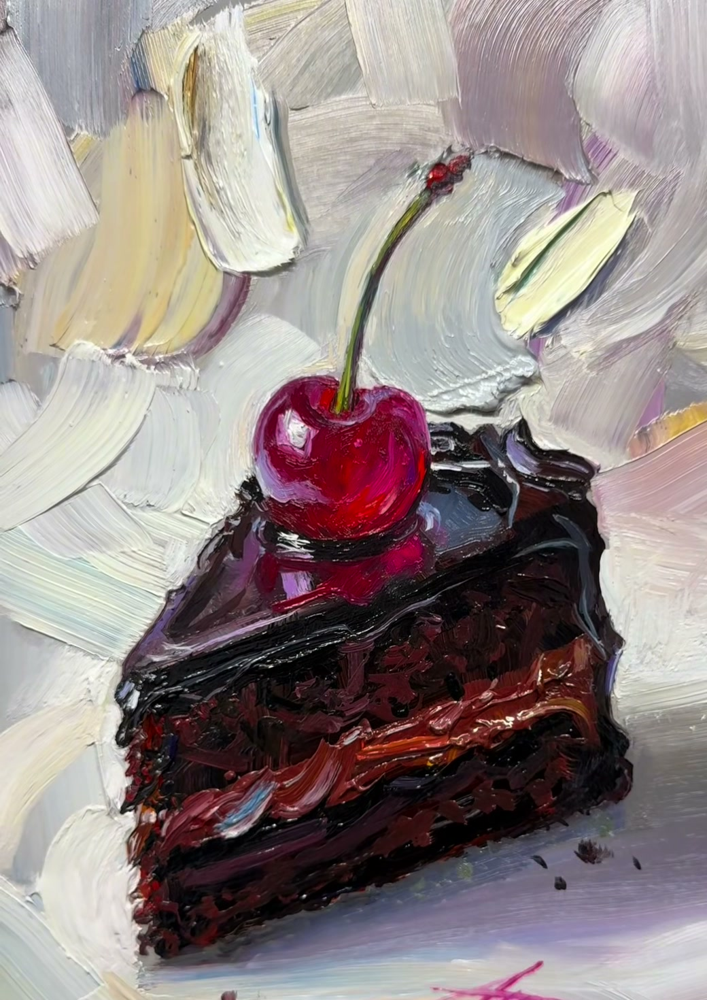
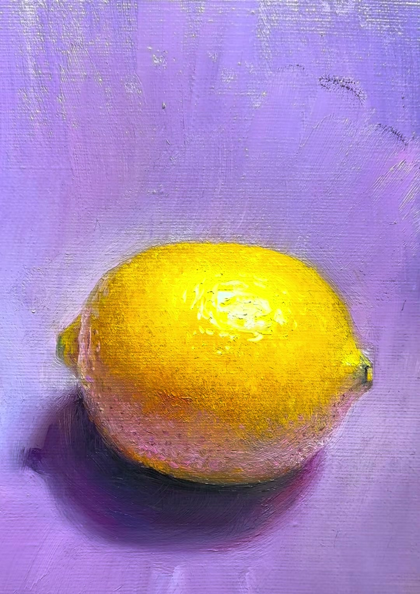
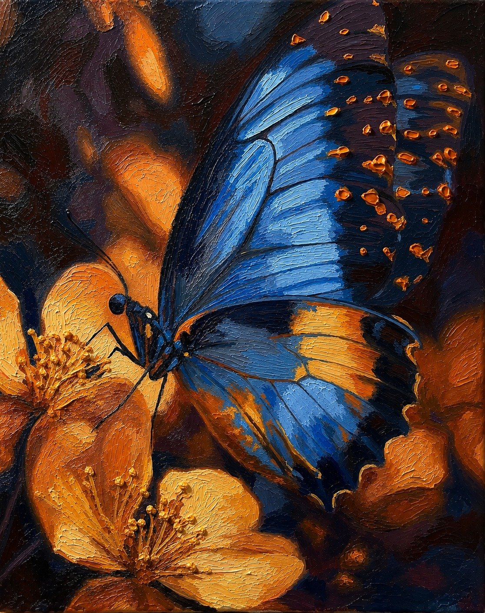
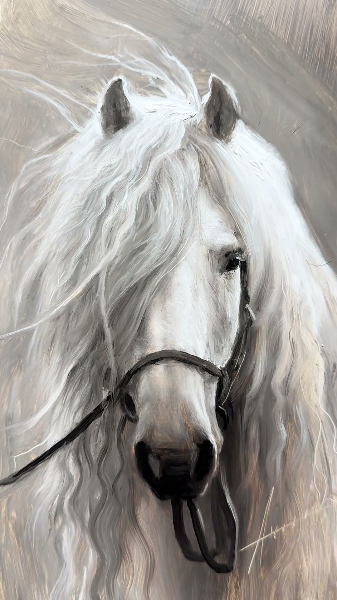
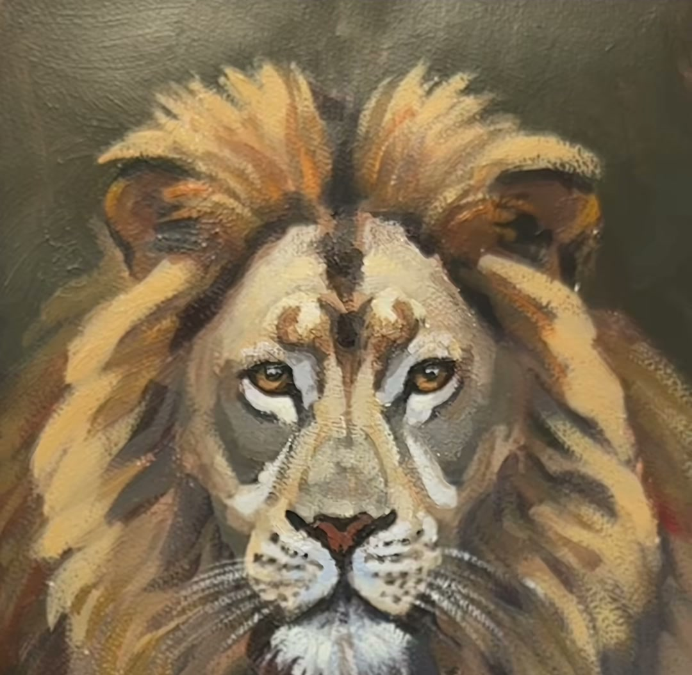
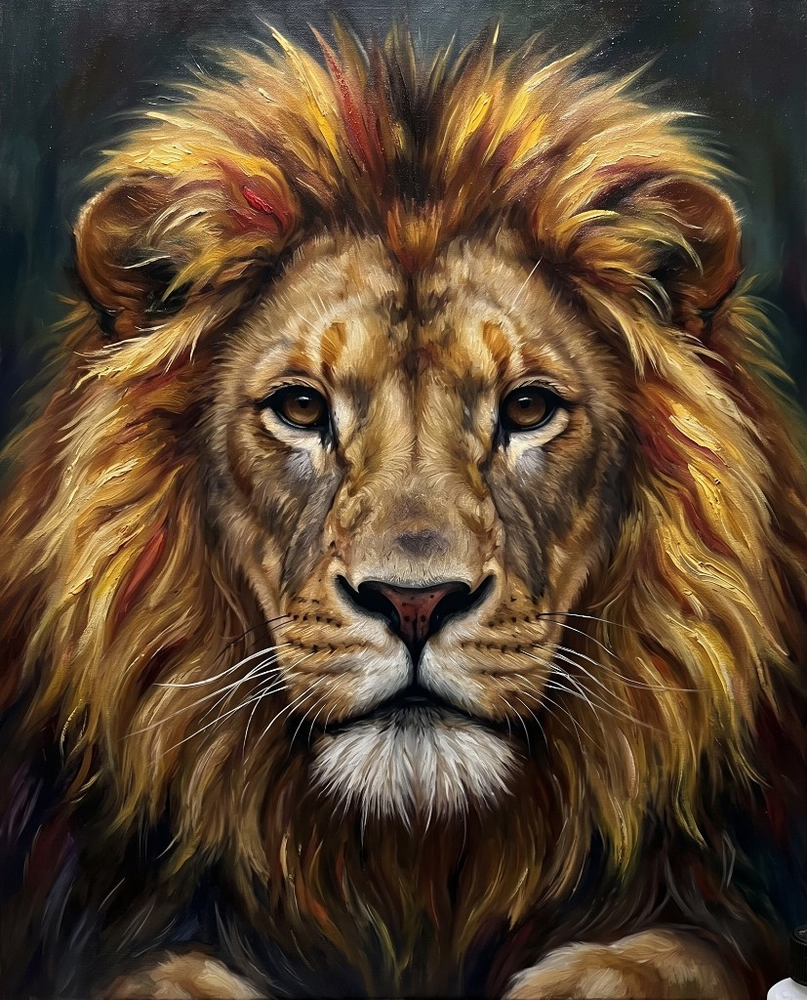

# Painting studies

Reference on the left, the original on the right.

## [Face pot](painting/works/face-pot)

<table>
<tr>
<td width="50%"></td>
<td width="50%"></td>
</tr>
</table>

## [Landscape](painting/works/landscape-photo)

<table>
<tr>
<td width="50%"></td>
<td width="50%"></td>
</tr>
</table>

## [Peony](painting/works/peony-palette-knife)

<table>
<tr>
<td width="50%"></td>
<td width="50%"></td>
</tr>
</table>

## [Drop](painting/works/drop-3d)

<table>
<tr>
<td width="50%"></td>
<td width="50%"></td>
</tr>
</table>

## [Cake](painting/works/cake-oil)

<table>
<tr>
<td width="50%"></td>
<td width="50%"></td>
</tr>
</table>

## [Lemon](painting/works/lemon-valeur)

<table>
<tr>
<td width="50%"></td>
<td width="50%"></td>
</tr>
</table>

## [Butterfly](painting/works/butterfly-by-numbers)

<table>
<tr>
<td width="50%"></td>
<td width="50%"></td>
</tr>
</table>

## [Horse](painting/works/horse-two-colors)

<table>
<tr>
<td width="50%"></td>
<td width="50%"></td>
</tr>
</table>

## [Wave](painting/works/transparent-wave)

<table>
<tr>
<td width="50%"></td>
<td width="50%"></td>
</tr>
</table>

## [Lion, alla prima](painting/works/lion-alla-prima)

<table>
<tr>
<td width="50%"></td>
<td width="50%"></td>
</tr>
</table>

## [Lion](painting/works/lion-gemini)

<table>
<tr>
<td width="50%"></td>
<td width="50%"></td>
</tr>
</table>

## [Eye](painting/works/portrait-eye)

<table>
<tr>
<td width="50%"></td>
<td width="50%"></td>
</tr>
</table>
